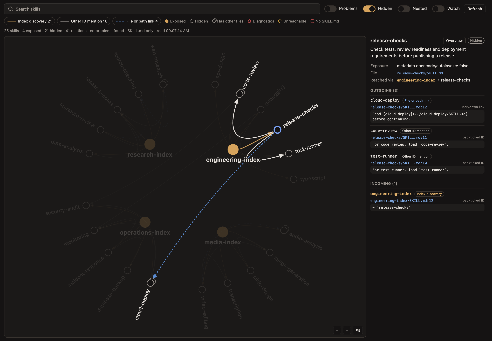

# Skill Graph for OpenChamber

**See what your agent can discover, and how your skills connect.**



*An example skill library in the extension's maximized panel. Select a skill to follow its connections and inspect the source behind each link.*

As a skill library grows, it gets harder to tell which instructions the agent sees up front, which it loads later, and which it may never find. Skill Graph gives you a map of that library inside [OpenChamber](https://openchamber.dev).

## Is it for you?

It's useful when you're writing or reorganizing OpenCode skills and want to:

- **Keep discovery lean.** See the exposed skills alongside the hidden specialists they point to.
- **Find overlooked skills.** Spot hidden skills with no recorded path from an exposed entry point.
- **Catch broken definitions.** Find missing descriptions, malformed frontmatter, naming mismatches, and missing files.
- **Check the evidence.** Click a connection to see the exact file, line, and text that created it.

The graph follows written references, not model behavior. It doesn't predict which skill an agent will choose, and it doesn't need an AI API or send your skill contents anywhere.

**Project-aware:** combines the server's `~/.config/opencode/skills` with `.opencode/skills`, `.claude/skills`, and `.agents/skills` under the active directory. Blue nodes mark **Global** skills; orange nodes mark **Project** skills, with labeled badges in the inspector. Filled versus hollow still means exposed versus hidden. Switching projects or worktrees refreshes the graph and clears the previous selection. With no project open, it shows global skills only.

When scanned sources define the same ID, the graph shows the effective definition and lists overridden files in the inspector. Following OpenCode V2 precedence, project `.opencode` wins over native global skills, which win over project `.agents`, then `.claude` skills.

**Scope limits:** ancestor directories outside the active directory, global compatibility folders, configured extra directories or HTTP catalogs, built-in skills, and agent permission rules are not inspected. The graph is a map of the scanned sources, not a complete runtime inventory.

## Install

You'll need **OpenChamber 2.5.0 or newer**, plus **Node.js 22.18+**, npm, and the `zip` command to build the extension.

```sh
git clone https://github.com/rndmcnlly/openchamber-skill-graph.git
cd openchamber-skill-graph
npm ci
npm run package
```

1. In OpenChamber, open **Settings → Extensions → Add**.
2. Paste the absolute path to your cloned `openchamber-skill-graph` folder, or select the generated `dist/openchamber-skill-graph.zip`.
3. Approve global skills access and access to files in the active project. Updating an older installation may ask for the added project-files permission.
4. Open **Skill Graph** from the extension rail. Use its maximize button for more room. There is no separate Extension pages entry.

The extension only reads files. OpenChamber's permissions technically also permit writes, and the project-files grant covers the active project, not just its skills folders. Skill Graph only scans the skill sources listed above and never writes files. It doesn't change your skills or run a background service.

The source checkout must be built before installation. If you install from the folder, rebuild and reopen the panel after updating it. If you install the ZIP, install a newly built ZIP to update.

## Explore your library

**Click a skill** to see its description, whether it's exposed or hidden, and its incoming and outgoing references. **Click a connection** to inspect its source. Filled nodes are exposed; hollow nodes are hidden. An extra outline means the skill has supporting files.

Search by name or description, or use the four switches:

| Switch | What it does |
| --- | --- |
| **Problems** | Focus on skills with errors or warnings. |
| **Hidden** | Include skills that aren't advertised to the agent. |
| **Nested** | Look for references in supporting Markdown files too. |
| **Watch** | Refresh automatically as files change while the panel is visible. |

Drag the graph to pan. Use **+**, **−**, or **Fit** to adjust the view. In wide mode, scrolling zooms; in a narrow panel, scrolling moves down to the details instead. Ctrl/Command-scroll still zooms in the narrow view.

A warning that a hidden skill is *unreachable* means no written reference leads to it from an exposed skill. It can still be loaded explicitly. If a connection looks surprising, inspect its evidence before changing your library.

## Development

See [AGENTS.md](AGENTS.md) for the implementation map, parsing rules, tests, and packaging details. Bug reports and contributions are welcome through [GitHub Issues](https://github.com/rndmcnlly/openchamber-skill-graph/issues).
